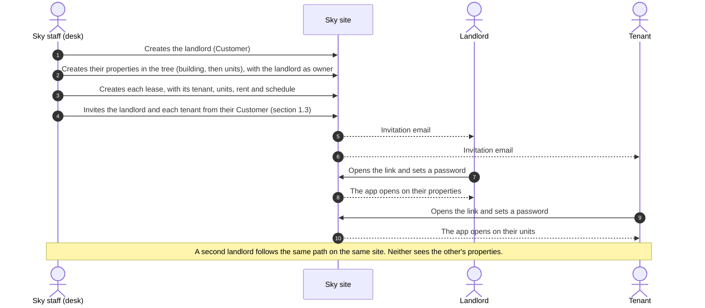
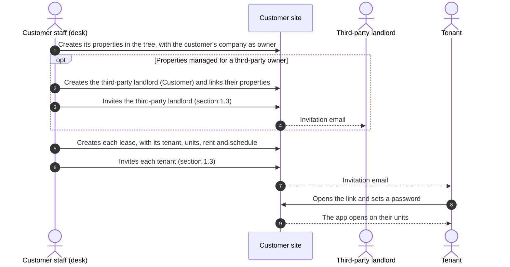
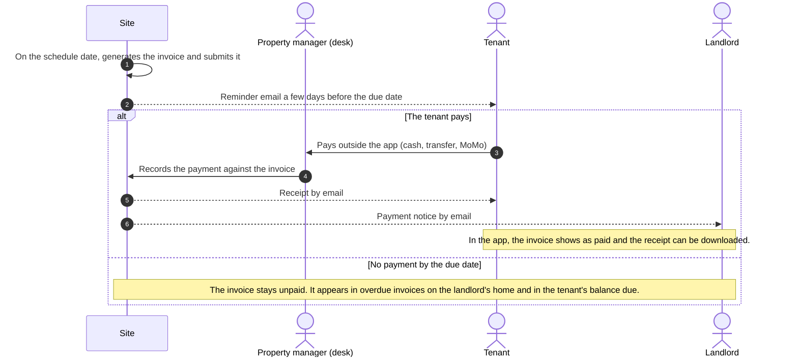
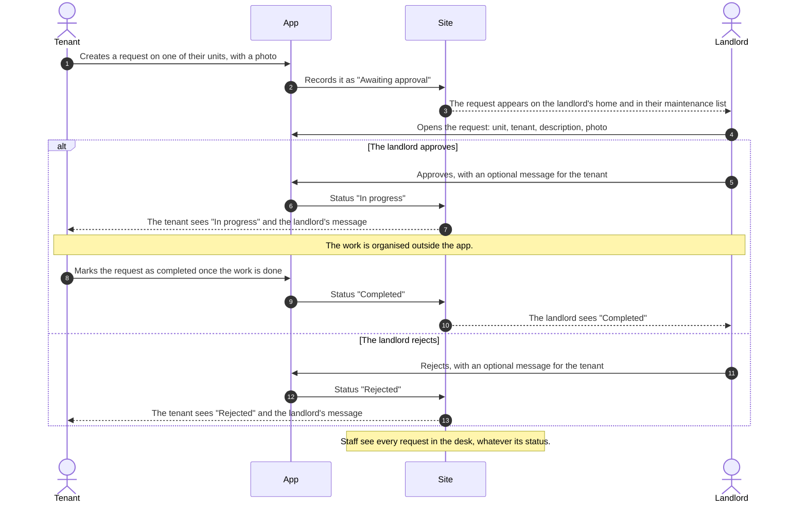
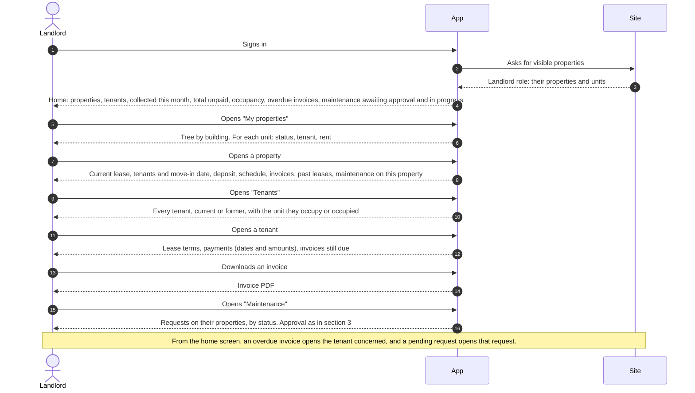
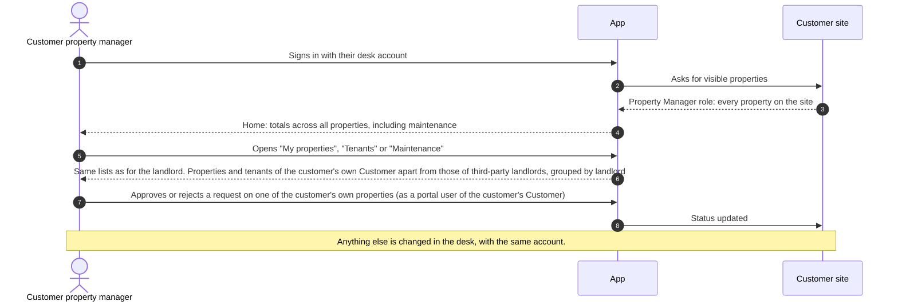
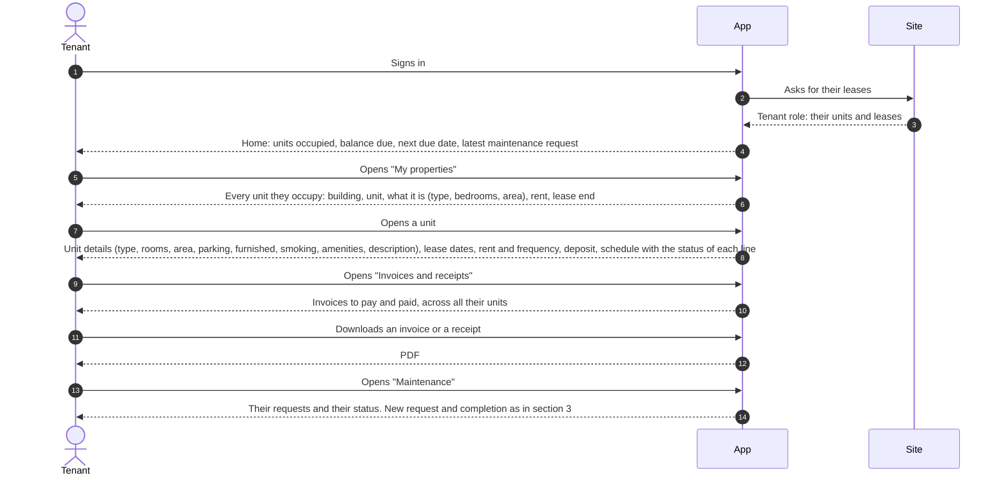

# Property app usage flows

This document describes how each role uses the app in the two operating modes defined in EP-01. The screens to build are shown separately, in `screens-immo-mode-a.mermaid` and `screens-immo-mode-b.mermaid`.

Online payment is not covered. Until it is designed, the property manager records each payment received (cash, bank transfer, MoMo outside the app) in the desk.

## Roles and access

| Role                              | Mode A: Sky owns an instance          | Mode B: A customer owns an instance                                                         |
| --------------------------------- | ------------------------------------- | ------------------------------------------------------------------------------------------- |
| System Manager / Property Manager | Sky staff. Desk only.                 | The customer's staff. Desk and app.                                                         |
| Landlord                          | Every landlord on the site. App only. | A third-party owner whose properties the customer manages. App only. This role is optional. |
| Tenant                            | App only.                             | App only.                                                                                   |

In both modes, one app serves every role. The role of the signed-in person decides the home screen and the properties shown:

- the property manager sees every property on the site;
- the landlord sees the properties they own (`unit_owner`), with their units;
- the tenant sees the units on their leases. A tenant can occupy more than one unit.

A person who is both landlord and tenant gets both spaces and switches between them from the account menu.

After sign-in, a landlord or a tenant opens the app. The property manager opens the app in mode B and the desk in mode A. In mode A, `/sky-immo` sends the property manager to the desk.

Management happens in the desk: landlords, properties, leases, tenants, accounts and payments. The app has two actions, both about maintenance: the tenant creates a request and marks it completed, and the landlord approves or rejects it.

## 1. Onboarding

### 1.1 Mode A: Sky onboards a landlord

Landlords have no instance of their own. Sky staff register them on the Sky site, under Sky's single company.

Onboarding starts as a manual checklist for Sky staff.

### 1.2 Mode B: the customer sets up its instance

The customer gets its own site. Its staff enter its properties. If the customer also manages properties for third-party owners, it can give them landlord access.

The owner is always set on every property, even when it is the customer's own company. Visibility rules therefore stay the same in both modes.

### 1.3 Invitation

Staff invite a person from the desk: they open the Customer and click **Invite to Sky-immo**.

- **Who can invite:** System Manager and Property Manager. A Property Manager also needs a role that can read Customer, such as Sales User, because PropMS gives them no access to it.
- **What the Customer needs:** an email address on the primary contact, and at least one property owned (a unit without an owner takes the owner of its nearest parent) or one active lease. The site also needs an outgoing email account.
- **What happens:** the user is created, or reused if the email already has one, and added to the Customer's Portal Users. They get Landlord if the Customer owns a property and Tenant if the Customer has an active lease. They receive an email with a link to choose a password, and the app opens after sign-in.
- **What does not happen:** the ERPNext Customer role is not given, so the ERPNext portal stays closed to them. A disabled user is refused until staff enable them. A staff member keeps their desk access and their default app.
- **Inviting again:** sends a new link and changes nothing else.

## 2. Invoicing and payment (both modes)

PropMS generates invoices from each lease's schedule. The property manager records payments received. The app only shows the result.

In mode B, a landlord exists only for properties managed for a third party. For the customer's own properties, the payment notice goes to the property manager.

## 3. Maintenance request: Issue in ERPNext (both modes)

A request goes through four statuses. The tenant opens it, the landlord decides, and the tenant closes it once the work is done.

| Status            | Set by                | Meaning                            |
| ----------------- | --------------------- | ---------------------------------- |
| Awaiting approval | Tenant, on creation   | The landlord has not decided yet   |
| In progress       | Landlord, on approval | The work is accepted and under way |
| Rejected          | Landlord              | The work will not be done          |
| Completed         | Tenant                | The work is done                   |

With the decision, the landlord can leave the tenant a message of up to 250 characters. It is kept on the request (`sky_immo_decision_note`, with `sky_immo_decided_by` and `sky_immo_decided_on`) and shown on both sides: "Your answer" for the landlord, "Answers from the landlord" for the tenant. The tenant does not see the landlord's name. The request is not a conversation: there is one answer, given with the decision.

Only a user linked to the owner of the property decides: a portal user of the Customer set as `unit_owner` on the property or on its nearest parent. In mode B, the customer's own properties have the customer's own Customer as owner, so a property manager decides on them by being a portal user of that Customer.

## 4. Landlord (both modes)

The landlord consults their properties and tenants, and decides on maintenance requests. They record no payment, tenant or lease.

## 5. Property manager in the app (mode B)

In mode B, the customer's staff can open the app to check their properties away from the office. They see the same screens as the landlord, over every property on the site.

In mode A, Sky staff work in the desk and do not need the app.

## 6. Tenant (both modes)

The tenant consults their units, leases and invoices, and reports problems in their home.

## 7. What differs between modes

| Point                       | Mode A                                  | Mode B                                                                              |
| --------------------------- | --------------------------------------- | ----------------------------------------------------------------------------------- |
| Who runs the desk           | Sky staff                               | The customer's staff                                                                |
| ERPNext company             | A single one, Sky's, for every landlord | The customer's                                                                      |
| Landlords                   | Every owner on the site                 | Third-party owners only, if any                                                     |
| Property manager in the app | No                                      | Yes, over every property, grouped by landlord                                       |
| Who approves maintenance    | The landlord                            | The user linked to the owner: the third-party landlord, or for the customer's own properties a property manager who is a portal user of the customer's Customer |
| Landlord and tenant screens | Identical                               | Identical                                                                           |
| Landing page of the property manager | The desk                       | The app                                                                             |
