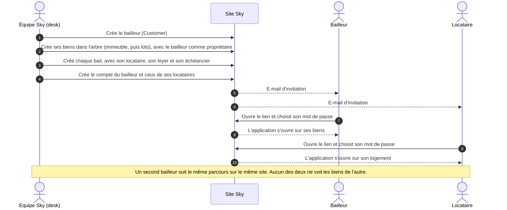
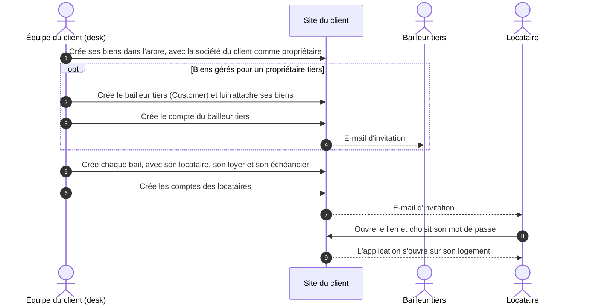
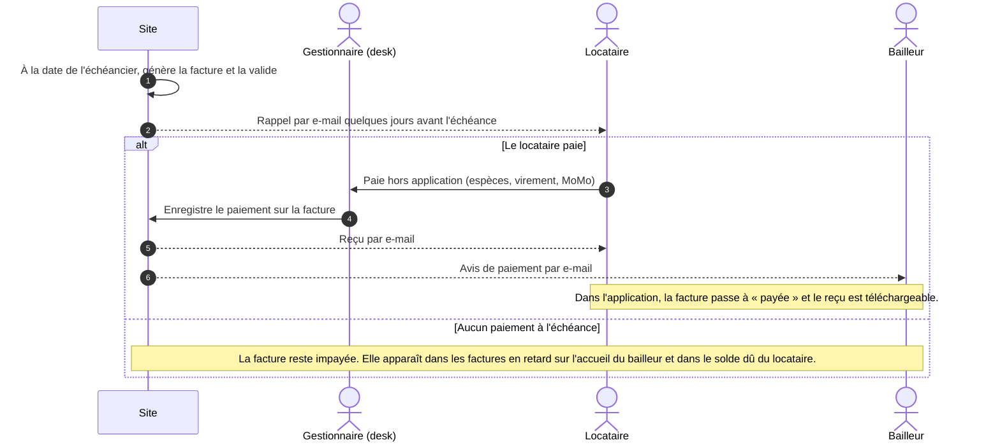
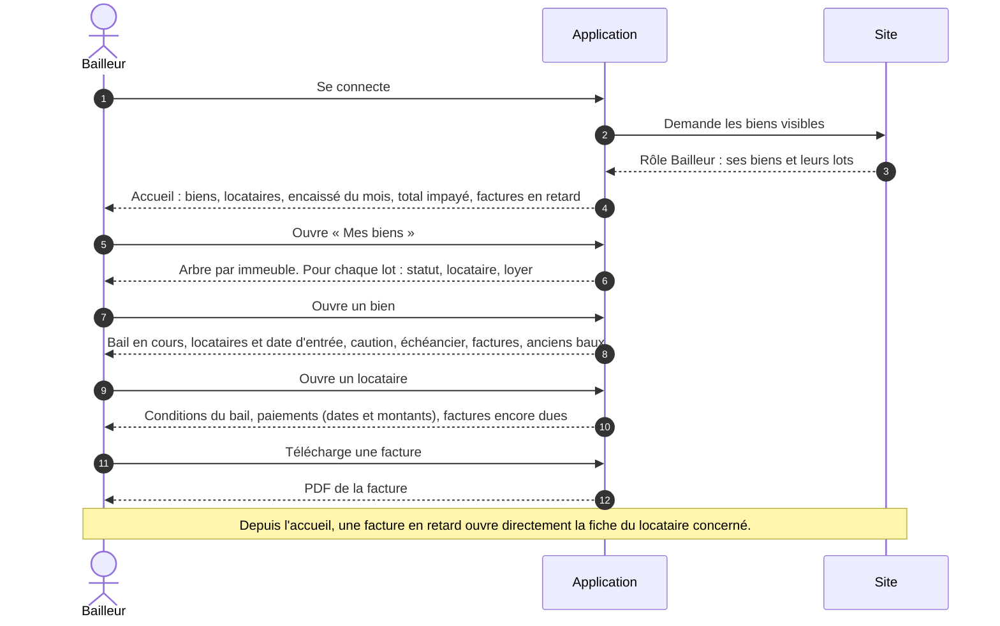
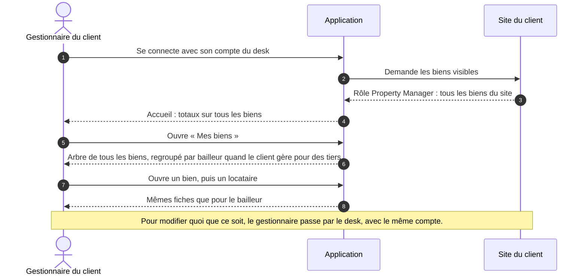
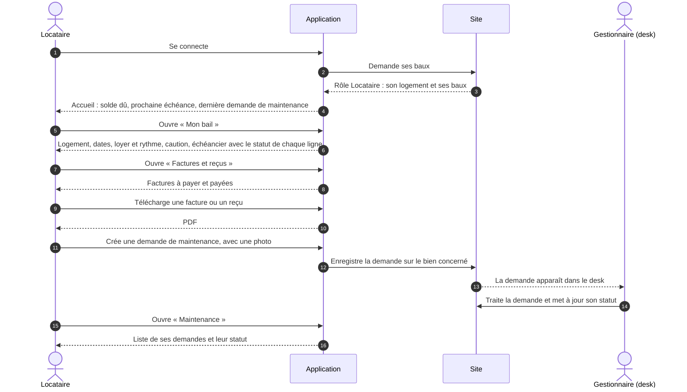

# Flux d'utilisation de l'application immobilière

Ce document décrit comment chaque rôle utilise l'application dans les deux modes opérationnels définis dans EP-01. Les écrans à implémenter sont présentés à part, dans `ecrans-immo-mode-a.mermaid` et `ecrans-immo-mode-b.mermaid`.

Le paiement en ligne n'est pas couvert. Tant qu'il n'est pas conçu, un paiement reçu (espèces, virement, MoMo hors application) est enregistré par le gestionnaire dans le desk.

## Rôles et accès

| Rôle | Mode A : Sky owns an instance | Mode B : A customer owns an instance |
| --- | --- | --- |
| System Manager / Property Manager | L'équipe Sky. Desk uniquement. | L'équipe du client. Desk et application. |
| Bailleur | Chaque bailleur du site. Application uniquement, en consultation. | Un propriétaire tiers dont le client gère les biens. Application uniquement, en consultation. Ce rôle est facultatif. |
| Locataire | Application uniquement. | Application uniquement. |

Dans les deux modes, une seule application sert tous les rôles. Le rôle de la personne connectée décide de l'écran d'accueil et des biens visibles :

- le gestionnaire voit tous les biens du site ;
- le bailleur voit les biens dont il est propriétaire (`unit_owner`), avec leurs lots ;
- le locataire voit les biens de ses baux.

Toute la gestion se fait dans le desk : bailleurs, biens, baux, locataires, comptes et paiements. Dans l'application, la seule action d'écriture est la demande de maintenance du locataire.

## 1. Mise en service

### 1.1 Mode A : Sky inscrit un bailleur

Les bailleurs n'ont pas d'instance à eux. L'équipe Sky les inscrit sur le site Sky, sous la société unique de Sky.

L'inscription commence comme une liste de contrôle manuelle pour l'équipe Sky.

### 1.2 Mode B : le client met en place son instance

Le client reçoit son propre site. Son équipe y saisit ses biens. Si le client gère aussi les biens de propriétaires tiers, il peut leur ouvrir un accès bailleur.

Le propriétaire est toujours renseigné sur chaque bien, même quand c'est la société du client elle-même. Les règles de visibilité restent ainsi les mêmes dans les deux modes.

## 2. Facturation et paiement (les deux modes)

PropMS génère les factures à partir de l'échéancier de chaque bail. Le gestionnaire enregistre les paiements reçus. L'application ne fait que montrer le résultat.

En mode B, le bailleur n'existe que pour les biens gérés pour un tiers. Pour les biens du client lui-même, l'avis de paiement va au gestionnaire.

## 3. Consultation par le bailleur (les deux modes)

Le bailleur consulte seulement. Il ne saisit ni paiement, ni locataire, ni bail.

## 4. Gestionnaire dans l'application (mode B)

En mode B, l'équipe du client peut ouvrir l'application pour consulter ses biens loin du bureau. Elle voit les mêmes écrans que le bailleur, mais sur tous les biens du site.

En mode A, l'équipe Sky travaille dans le desk et n'a pas besoin de l'application.

## 5. Locataire (les deux modes)

Le locataire consulte son bail et ses factures. Il peut aussi signaler un problème dans son logement.

## 6. Ce qui diffère d'un mode à l'autre

| Point | Mode A | Mode B |
| --- | --- | --- |
| Qui tient le desk | L'équipe Sky | L'équipe du client |
| Société ERPNext | Une seule, celle de Sky, pour tous les bailleurs | Celle du client |
| Bailleurs | Tous les propriétaires du site | Seulement les propriétaires tiers, s'il y en a |
| Gestionnaire dans l'application | Non | Oui, sur tous les biens, regroupés par bailleur |
| Écrans bailleur et locataire | Identiques | Identiques |
